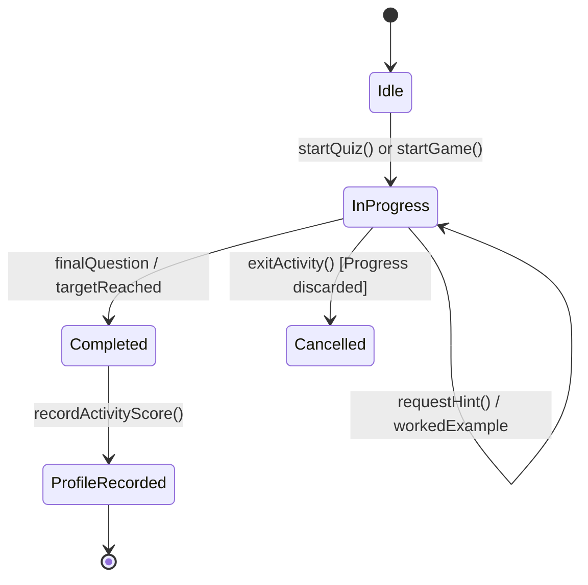

# System Architecture: Raven & Llama Learning

This document provides a comprehensive technical overview of the architecture, data models, runtime lifecycle, and security boundaries in the **Raven & Llama Learning** platform. Future contributors and AI agents should consult this document before making structural changes.

---

## 1. High-Level Technology Stack

* **Frontend**: Vanilla JavaScript (ES2022+ modules and browser scripts). No bundler (Webpack/Vite/Rollup) or transpiler (Babel/TypeScript) is used.
* **Styling**: Tailwind CSS v4 via `@tailwindcss/cli`, compiling `tailwind.input.css` into static `public/css/tailwind.css`.
* **Visual Effects**: Self-hosted `public/js/vendor/confetti.js` for lightweight particle celebration effects.
* **Backend Runtime**: Dual-mode architecture:
  * **Production & Previews**: Cloudflare Workers with static asset hosting and Cloudflare D1 SQL database.
  * **Local Development**: Node.js HTTP server (`server.js`) with built-in SQLite (`data/accounts.sqlite`) mimicking Worker endpoints and security behaviors.
* **Database / Persistence**:
  * Local: Node.js 22.5+ built-in `node:sqlite` driver storing `data/accounts.sqlite`.
  * Cloudflare: D1 database `raven-llama-accounts` (production) and `raven-llama-accounts-preview` (isolated previews).
* **Testing Harness**: Node.js built-in test runner (`node --test`), Playwright Chromium for E2E browser tests.

---

## 2. Directory Layout & Key Modules

```text
public/
├── index.html                     # Single-page application root shell
├── css/
│   ├── styles.css                 # Custom animations, overrides, and theme variables
│   └── tailwind.css               # Generated Tailwind stylesheet (committed to git)
├── js/
│   ├── shared/
│   │   ├── app.js                 # Central controller, routing, navigation, modal states
│   │   ├── accounts.js            # ProfileManager, guest vs signed-in session management
│   │   ├── activity-engine.js     # Standardized quiz & arcade activity lifecycle engine
│   │   ├── educational-feedback.js# Hints, worked examples, retry controls
│   │   ├── mascot-companion.js    # Animated mascot companion (Raven & Llama)
│   │   ├── cosmetic-shop.js       # Star-purchasable avatar cosmetics catalog
│   │   ├── daily-challenges.js    # Deterministic UTC daily challenge generator
│   │   ├── achievement-badges.js  # Derived milestone badges engine
│   │   ├── progress-analytics.js  # Mastery heatmaps, 7/30/90-day progress trends
│   │   └── audio.js               # Web Audio sound effects & synthesis manager
│   ├── learning/
│   │   ├── centre.js              # Learning Centre subject directory view
│   │   └── quests.js              # Multi-activity cross-subject quests
│   ├── mathmasters/
│   │   ├── curriculum.js          # 9 belt ranks (White to Black/Platinum) and 46 skills
│   │   ├── generators.js          # Procedural question generators per belt skill
│   │   ├── activities.js          # Arcade and interactive math mini-games
│   │   ├── world.js               # Maths World map & activity selectors
│   │   ├── fraction-pizza.js      # Interactive pizza fraction builder
│   │   ├── money.js               # Shopkeeper Australian currency practice
│   │   └── telling-time.js        # Analogue & digital clock trainer
│   ├── spelling/
│   │   └── safari.js              # Safari adventures, Spell It lists, Aussie speech synthesis
│   ├── science/
│   │   ├── explorers.js           # 4 Explorer missions (400 questions total)
│   │   ├── solar-system.js        # Planet ordering activity & factual guide
│   │   ├── plant-life-cycle.js    # 6-stage biological sequencing activity
│   │   ├── food-chains.js         # Habitat trophic levels activity
│   │   └── virtual-lab.js         # Scientific state change & mixture simulations
│   ├── geography/
│   │   ├── country-data.js        # Interactive country dataset (flags, capitals, facts)
│   │   ├── world-map-context.js   # 177-country background SVG vector paths
│   │   ├── world-map.js           # Interactive SVG world map component (pan/zoom)
│   │   └── country-activities.js  # Flag Detective & Capital Cities activities
│   ├── history/
│   │   ├── events.js              # 104 curated historical event records
│   │   └── timeline-builder.js    # Drag-and-drop chronological timeline builder
│   ├── brain-power/
│   │   └── brain-power.js         # Pattern Recognition, Memory Match, Code Breaker
│   ├── life-skills/
│   │   └── party-planner.js       # Budgeting & event planning activity
│   └── timetables/
│       └── timetables.js          # Times Tables practice arena & speed challenges
lib/
├── account-api.mjs                # Shared account business logic, hashing, validations
├── local-account-store.mjs        # SQLite persistence adapter for local development
└── d1-account-store.mjs           # Cloudflare D1 persistence adapter
migrations/
└── 0001_initial.sql               # D1 accounts and sessions schema
```

---

## 3. Core Runtime Lifecycles

### 3.1 Single-Page Application (SPA) Navigation
* Routing is hash-less and managed via `App.prototype.navigate(viewId, ...args)` and `history.pushState`.
* Views inject dynamic HTML into the `#app-main` container.
* Modals (Profile, Progress Report, Settings, Cosmetics Shop) render inside overlay containers and clean up their own event listeners upon dismissal.

### 3.2 Activity Engine Lifecycle (`ActivityEngine`)
All learning activities (quizzes, arcade games, sequencing, simulations) are standardized through `public/js/shared/activity-engine.js`:



* **Accuracy vs Points**: Quizzes track `correctAnswers` and `totalAnswers`. Final accuracy is recorded as a percentage. Arcade mini-games record points; accuracy is marked "Not measured".
* **Star Rewards**: Star awards are granted once upon activity completion according to configured reward values.

---

## 4. Accounts, Privacy & Persistence

### 4.1 Guest Mode vs Authenticated Accounts
* **Guest Mode**: All progress, quiz scores, daily challenges, and unlocked cosmetics are kept in memory only (`sessionStorage` or application memory). No data is written to `localStorage`, cookies, or remote endpoints. When the window/tab closes, guest data is cleared.
* **Authenticated Mode**: Progress is securely synchronized to the server via `/api/progress`. Account records store:
  - Account ID (UUID generated server-side).
  - Hashed password (PBKDF2 with salt).
  - Session token (hashed, stored in `HttpOnly`, `SameSite=Lax` cookie).
  - Profile JSON blob (school years, subject overrides, activity progress, badges, daily challenge records, owned cosmetics).
  - Learning preferences include theme, school-year overrides, and the sound-effects setting; guest-only Parent Dashboard changes stay in memory.

### 4.2 Security Rules
* **No Account Listing**: No API endpoint allows listing accounts or looking up other users.
* **Session Scope Only**: All progress reads/mutations are derived strictly from the authenticated cookie session. Never accept a client-supplied account ID.
* **Progress Reset**: `POST /api/progress/reset` requires the authenticated session and an explicit confirmation phrase. It clears learning records for that session's account while preserving account identity, preferences, and owned cosmetics.
* **Rate Limiting**:
  - Registration: 30 attempts per IP per minute.
  - Login: 60 attempts per IP per minute, 10 attempts per IP + username pair.
* **Asset Cache Revalidation**: Static assets must revalidate using `Cache-Control: public, max-age=0, must-revalidate` with `ETag`. No query string cache busters (`?v=...`) are allowed.
