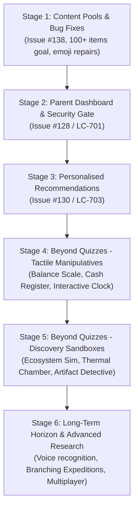

# Multi-Stage Strategic Plan: Replacing Quizzes, Quality Refinement & Innovation Roadmap

This document serves as the master blueprint for transitioning **Raven & Llama Learning** from a quiz-centric platform into a deeply interactive, inquiry-based educational experience. It covers immediate bug resolutions, content pool expansions (to meet the 100+ items goal), core architectural additions, tactile manipulatives replacing quizzes, and longer-term research into future learning mechanics.

## Current Status (21 November 2026)

- **Stages 1–3: implemented.** Content-pool repairs, the core parent dashboard/settings, and deterministic recommendations are delivered.
- **Stages 4–5: first versions implemented.** Tactile activities and discovery experiences are available, while several still augment existing quizzes or use deliberately finite/simplified models.
- **Remaining tracked follow-ups:** verify the reported desktop Chrome flag-rendering problem; connect Balance Scales to Blue Belt equation training and add unknown-value weights; decide whether to add a learner pace control to the Parent Dashboard.
- **Stage 6: not started.** Voice recognition, branching historical expeditions, and multiplayer remain research proposals.
- No GitHub issues or pull requests were open when this status was reviewed. Create focused issues before starting the future work above.

---

## Executive Summary: The 6-Stage Roadmap



---

## Stage 1: Content Pools, Question Breadth & Bug Resolutions (Complete)

**Primary Objective**: Eliminate known defects and bring eligible generated activities toward the platform standard of **at least 100 distinct items per activity**. Finite historical evidence collections remain explicitly finite.

### 1.1 Fix History Event Icons (Encoding Repair)
* **Status — implemented**: All 104 event records have thematic emoji icons. `tests/unit/history-timeline.test.js` asserts pictographic Unicode icons and rejects placeholder question marks; the pool remains 104 unique, sourced events.

### 1.2 Expand Geography Hub Dataset to 100+ Countries
* **Problem (resolved)**: The quiz dataset started with 18 countries, even though `world-map-context.js` contains SVG paths for 177 countries. Flag Detective and Capital Cities therefore covered too few countries.
* **Resolution — implemented**: The shared `country-data.js` pool now includes 193 UN member countries spanning Africa, Asia, Europe, North America, South America, and Oceania, with local flags, capitals, continents, facts, and linked sources.
* **Test**: Add unit test in `tests/unit/geography-country-activities.test.js` asserting `countries.length >= 160` and zero duplicate country/flag/capital combinations.
* **Follow-up note — implemented**: Expanded the shared country pool from 110 to 165 sovereign countries, reusing map paths for 55 additional eligible countries. Audited all 177 outlines; dependent territories, Antarctica, and disputed or special-status features remain in the map context but outside the quiz pool, as documented in `docs/SUBJECTS_AND_ACTIVITIES.md`.
* **Map-page facts follow-up — implemented**: Each country now has at least five sourced facts, combining the existing country highlight with capital, continent, official languages, currency, area, coastline status, and land-border details where available. A different fact is selected when the learner changes away from and returns to a country. Reference data is bundled locally with ODbL attribution and licensing; no live API is required.
* **Map flag display — implementation shipped, Chrome verification outstanding**: Self-hosted SVG flags appear in the selected-country panel, country list, Flag Detective, and Capital Cities. The user later reported that flags still fail in desktop Chrome while working on a phone. Reproduce that report in Chrome before calling cross-browser rendering resolved. The map caption uses the actual number of highlighted countries.
* **Small-island map follow-up — implemented**: Added twelve small island countries, including Mauritius, using enlarged schematic markers where Natural Earth 1:110m does not preserve visible geometry. Markers are explicitly not to scale and have large screen-constant selection targets. Sixteen further small countries complete UN-member coverage. Map controls and pinch zoom now reach 16×.

### 1.3 Expand Life Skills "Plan a Party"
* **Status: Complete**: The activity has four budgeted scenarios: Birthday Party ($100), Camping Trip ($150), School Science Fair ($75), and Pizza Movie Night ($50).
* The 24-item catalog is grouped into Venue, Food & Drink, Entertainment, Gear, and Decorations. Each round samples ten items (two per category), includes the scenario's featured item, and assigns two or three required targets; the remaining items are optional.
* Unit coverage in `tests/unit/party-planner.test.js` checks the scenarios, item catalog, sampling, required targets, and budget evaluation. Browser coverage in `tests/e2e/plan-party.spec.js` checks the route, controls, budget feedback, and successful plan completion.

### 1.4 Expand Science Lab Food Chains & Virtual Lab
* **Food Chains**: Expanded `public/js/science/food-chains.js` to 10 sourced habitats. Five distinct chains are randomly selected per run; the deep-sea vent model correctly starts with chemical energy rather than sunlight.
* **Virtual Lab**: Expanded `public/js/science/virtual-lab.js` to 17 carefully sourced outcomes. Item filters group materials, prepared mixtures, conditions, and tools; supported outcomes link to their source.

### 1.5 Expand MathMasters Brown Belt Fractions
* **Status — implemented**: Brown Belt fraction practice covers denominators 2–12, proper/improper/mixed numbers, and circle, bar, or grid models. Unit tests enforce at least 100 distinct problems and answerable visual rendering.
* **Fraction Pizza UI follow-up — implemented**: Replaced the square grid and pizza icons with wedge-shaped pizza slices, a visible crust, cheese, and toppings. Slices remain selectable by touch and keyboard and draggable on desktop. Their geometry lives in the stylesheet because the app's Content Security Policy blocks inline style attributes; browser coverage checks that each supported slice is rendered as a distinct clipped wedge.

---

## Stage 2: Parent Dashboard & Settings Controls (Core Features Implemented)

**Primary Objective**: Deliver a secure, dedicated parent portal enabling personalized difficulty configurations, learning pace controls, and safe progress management.

### 2.1 Backend & Authentication Layer
* **Parent Access Gate**:
  - Implement optional 4-to-6 digit Parent PIN for signed-in accounts.
  - Store PIN as a PBKDF2 hash with unique salt in the account profile; never store plaintext PINs.
  - Rate-limit PIN verification (5 attempts per minute) on `/api/auth/parent-verify`.
* **Reauthentication**: Require session re-entry or PIN verification before destructive operations.
* **Progress Reset Endpoint**:
  - Add scoped endpoint `/api/progress/reset` allowing parents to selectively reset activity scores and history while preserving account credentials and earned cosmetics.

### 2.2 Parent Dashboard UI & Controls
* **Navigation Entry**: Accessible lock icon in the top header and inside account settings.
* **Global & Subject Difficulty Matrix**:
  - Unified grid allowing parents to set school-year overrides individually for Mathematics, Science, and English/Spelling.
  - Visual guidance showing current year level (Foundation to Year 12) and recommended activity tiers (Easy, Medium, Hard).
* **Audio & Sensory Preferences**:
  - Global speech synthesis speed slider ($0.75\times$ to $1.25\times$).
  - Sound effects toggle and Dyslexia-friendly typography toggle.
* **Dyslexia-friendly typography — implemented**: Add a profile-synced toggle for a sans serif typeface with increased letter spacing and line height; guest selection stays in memory.
* **Guest Safety**: In guest mode, display a clear advisory that settings and progress remain memory-only.
* **Audio preference control — implemented**: Add a parent-managed spoken-audio speed slider from 0.75× to 1.25× and apply it to hints and spelling pronunciations; keep guest changes in memory.
* **Status**: Parent PIN access, session-scoped progress reset, year/difficulty settings, theme/sound/speech/typography preferences, and guest privacy messaging are implemented. A separate learner pace control (for example, session length or activity pacing) is not implemented; keep it as optional follow-up rather than implying it shipped.

---

## Stage 3: Personalised Learning Recommendations (Implemented)

**Primary Objective**: Turn student activity history into deterministic, explainable next-step recommendations that adapt to mastery and practice recency.

### 3.1 Deterministic Recommendation Engine (`lib/recommendations.mjs` & client)
* **Algorithm Inputs**:
  - Current school year and subject difficulty overrides.
  - Recent accuracy per skill in `activityProgress` (identifying skills with $< 70\%$ accuracy).
  - Recency gap (identifying core curriculum areas not practiced in $> 7$ days).
  - Daily challenge completion state.
* **Ranking & Selection**:
  - Priority 1: Remediation (low accuracy in recent attempts).
  - Priority 2: Incomplete Quests / Unearned Badges.
  - Priority 3: Breadth & Discovery (unpracticed subjects).
  - Fallback: Year-appropriate core activities when history is sparse.
* **Data Privacy**: All computations occur locally in-browser or strictly within the authenticated account session; zero external analytics tracking.
* **Recommendation rules**: Use up to 30 days of valid quiz attempts for accuracy; require at least three answers before treating a score under 70% as a support signal. Recommend practice gaps after more than seven days, cap results at three with deterministic ordering, skip completed daily activities for the current UTC day, and launch only catalogued activities available in the app. Apply current subject-year difficulty when the chosen activity supports it; otherwise use a neutral empty state when nothing eligible remains.

### 3.2 Learning Centre Recommendation Cards
* Surface top 3 recommended activities prominently on the Home dashboard and Learning Centre header.
* Include plain-language explanations:
  - *"Let's practice: You scored 60% on fractions last week. Try Fraction Pizza to level up!"*
  - *"New discovery: You haven't explored the History Timeline yet. Step back in time!"*
* Provide one-click direct launch buttons into the recommended activity.
* **Status**: The deterministic recommendation engine and accessible cards are available in both the Home dashboard and Learning Centre.

---

## Stage 4: Replacing Quizzes — Tactile Manipulatives (Beyond Quizzes Phase 1)

**Primary Objective**: Move primary mathematics and language learning from multiple-choice testing into direct physical manipulation.

**Status**: First tactile versions for all four proposals are implemented. They augment existing learning flows; full replacement of the linked quiz/training paths remains follow-up work.

```text
Quiz Mindset:        "What is 3/4 + 1/4? [A] 1  [B] 2/4  [C] 4/8  [D] 1/2"
Manipulative Mindset: "Drag pizza slices into the box until you have exactly one whole pizza."
```

### 4.1 Digital Balance Scale (Maths Masters Algebra & Equations)
* **Status: Integrated into the Blue Belt `blue_balanced_equation` training path and the `balance-scales` arcade.**
* Learners add, remove, or clear 1, 2, 5, 10, and 20-unit weights on the right pan until it matches the fixed left pan. The beam tilts toward the heavier side and settles level when balanced; a live status reports each pan's total and which side is heavier.
* Weight controls are keyboard and touch accessible. Training still uses the existing question pool, timer, scoring, retry, and progress lifecycle, but learners now build answers on the scale rather than choose a multiple-choice answer. An occasional mystery `x` block can be weighed against known weights; equal operations that remove the same amount from both pans remain future work. The arcade also includes lifting balloons with values −1, −2, and −5 so learners can explore negative weights and correct an overshoot.

### 4.2 Cash Register & Change Counter (Maths World Shopkeeper)
* **Status: First tactile version implemented** in the existing Shopkeeper mode.
* The customer's basket and payment are shown on a counter, with distinct cash drawer slots grouped into Australian coins and notes. Learners drag money to the change tray or select denominations by touch and keyboard; a screen-reader live total updates as they build the change.
* The receipt shows only the basket total and the amount paid before the learner answers, so it does not reveal the change. The prompt teaches counting up from the basket total to the payment.
* This enhances the Shopkeeper mode in `public/js/mathmasters/money.js`; the other Money Masters activities remain available.

### 4.3 Interactive Clockwork Hands (Maths World Telling Time)
* **Status — implemented**: Learners can drag either hand with mouse or touch, adjust by keyboard, and see the hour hand move proportionally as minutes change. This enhances `public/js/mathmasters/telling-time.js`; broader time-training replacement is not claimed.

### 4.4 Kinetic Phonics Soundboard & Blending Bar (Spelling Safari)
* **Status: First tactile version implemented** in Phonics Trail. The existing phonics gap choices now fill an interactive grapheme row; tapping a tile plays its pronunciation, and a selected attempt can be blended with a button or a horizontal swipe across the tiles. Learners can still submit the word to the existing scoring and feedback flow.
* **Mechanics**:
  - Students see interactive letter/digraph tiles (`sh`, `i`, `p`).
  - Tapping each tile triggers the browser's built-in, English-Australian-prioritized speech synthesis; if unavailable, the learner can still read and check their word.
  - Swiping a finger across the "Blending Bar" or activating its accessible button plays the attempted word, showing phonological assembly.
* **Target Activity**: Enhances `public/js/spelling/safari.js` Phonics Trail.

---

## Stage 5: Replacing Quizzes — Discovery Sandboxes & Deductive Mysteries (Beyond Quizzes Phase 2)

**Primary Objective**: Transition Science, History, and Geography into exploratory sandboxes and mystery-solving investigations.

### 5.1 Trophic Ecosystem & Population Sandbox (Science Lab)
* **Status: First pond-model version implemented** in `public/js/science/ecosystem-sandbox.js`.
* Learners adjust four population groups (algae, tadpoles, fish, kingfishers) with keyboard/touch controls and advance one simplified day at a time. Population caps and each growth/feeding rule are visible to the learner.
* The first challenge asks learners to keep all four groups present for five days. The model is explicitly described as a simplified exploration, not a prediction of real pond dynamics, and does not award quiz progress.
* **Future work**: add a timeline graph, more organisms, and longer open-ended challenges after evaluating the first model with learners.

### 5.2 States of Matter Thermal Chamber (Science Lab)
* **Status — implemented**: The temperature control shows distinct solid, liquid, and gas particle states, phase boundaries, and a condensation-lid interaction. A follow-up fix makes particle arrangements visibly change with temperature; CSS motion respects reduced-motion settings.

### 5.3 Historical Artifact Detective (History Hub)
**Status: First finite investigation slice implemented.** Four sourced cases cover the Rosetta Stone, an Indus stamp seal, the Sutton Hoo helmet, and a Late Babylonian tablet. Each case reveals three clues before period selection, then provides an explanation and museum citation. This is a deliberately small evidence-backed set; broader artifact coverage requires additional verified records. It adds an inquiry activity alongside Timeline Builder rather than replacing the timeline.
* **Concept**: A forensic archaeological investigation tool replacing rote historical date memorization.
* **Mechanics**:
  - The student is presented with an unidentified artifact unearthed at a dig site (e.g. an inscribed clay fragment, a bronze coin, a navigational astrolabe).
  - Tools provided:
    * **Magnifying Glass**: Inspect symbols, script, and imagery.
    * **Material Analyzer**: Test composition (papyrus, terracotta, iron, silk).
    * **Stratum Depth / Carbon Gauge**: Approximate the chronological epoch.
  - Students collect 3 observational clues and select the civilization or historical period that produced it, unlocking the artifact for the museum collection.

### 5.4 Globe Trotter Clue Trail (Geography Hub)
* **Status — first version implemented**: Five replayable, three-clue passport mysteries work with either map selection or the keyboard-friendly country list. A correct answer opens the existing flag and fact panel. Broader mystery content remains optional expansion.

---

## Stage 6: Long-Term Horizon & Advanced Research

**Primary Objective**: Investigate cutting-edge educational mechanics, voice interaction, and cooperative features for future platform iterations.

**Status**: Feasibility research started for 6.1–6.3. Implementation remains gated on privacy, historical, cultural, security, and cost reviews.

### 6.1 Voice Recognition & Verbal Spelling (Web Speech Recognition)
* **Research Focus**: Can speech recognition reliably assess oral reading and verbal spelling for primary students without external cloud services?
* **Feasibility review (2026-11-21)**:
  - The browser Web Speech Recognition API remains limited in availability. Where recognition is available, browsers may use a remote service by default; that can send the learner's audio to a service and may fail offline ([MDN Web Speech API](https://developer.mozilla.org/en-US/docs/Web/API/Web_Speech_API/Using_the_Web_Speech_API), [MDN SpeechRecognition](https://developer.mozilla.org/en-US/docs/Web/API/SpeechRecognition)).
  - Chrome added an on-device recognition path in Chrome 139. It requires a supported language pack and explicit `processLocally = true`; the site can query availability and offer installation. This is a possible privacy-preserving route, but it does not establish support across the browsers and devices used by learners ([Chrome 139 release notes](https://developer.chrome.com/release-notes/139), [MDN on-device recognition](https://developer.mozilla.org/en-US/docs/Web/API/Web_Speech_API/Using_the_Web_Speech_API#on-device_speech_recognition)).
  - Recommendation: if prototyped, limit the first activity to short, explicit letter-by-letter spelling. Require an intentional learner action, show a clear listening state and stop control, and use on-device recognition only. If the browser or language pack cannot support that path, keep the existing typed or tile-based response; do not silently fall back to remote recognition.
  - Treat each spoken attempt as transient: do not persist or upload audio or transcripts. Show the recognized letters back to the learner before checking them, and let the learner edit or retry. This reduces the effect of accents, noise, and recognition errors on scoring.
  - Gate before implementation: decide how learner/parent consent is presented and verify the target browser/device matrix, including unsupported browsers, unavailable language packs, denied microphone access, no-speech, and cancellation. The Web Speech API spec calls for explicit informed consent, an obvious recording indicator, and a user-visible way to stop recording ([W3C Web Speech API security and privacy considerations](https://dvcs.w3.org/hg/speech-api/raw-file/tip/webspeechapi#security)).

### 6.2 Branching Historical Expeditions (Choose-Your-Own-Adventure)
* **Research Focus**: Interactive branching narratives exploring major human migrations and historical journeys.
* **Feasibility review (2026-11-21)**:
  - Ground each story in one named corridor and period. UNESCO describes the Silk Roads as an interconnected network of changing land and sea routes, not a single road; many merchants travelled only sections and exchanged cargo along the way. The existing Chang'an-to-Constantinople framing should therefore become a linked route with regional stops and hand-offs, not one caravan making the whole journey ([UNESCO: About the Silk Roads](https://www.unesco.org/en/silk-roads/about-silk-roads), [UNESCO: Chang'an-Tianshan Corridor](https://whc.unesco.org/en/list/1442/)).
  - A Pacific wayfinding story is feasible, but must name and represent a specific tradition. Hōkūleʻa describes Polynesian use of stars and ocean swells; UNESCO separately documents Carolinian wayfinding in Micronesia. Do not blend these into one generic Pacific navigation system ([Hōkūleʻa: Holding a Course](https://worldwidevoyage.hokulea.com/education-at-sea/polynesian-navigation/polynesian-non-instrument-wayfinding/), [UNESCO: Carolinian wayfinding and canoe making](https://ich.unesco.org/en/RL/carolinian-wayfinding-and-canoe-making-01735)).
  - Recommendation: prototype one short Silk Roads chapter first, set on a cited corridor with 3–4 stops. Make choices show trade-offs in terrain, rest, supplies, and exchange; explain that outcomes are a simplified teaching model rather than a reconstruction of one documented journey. Attach sources to each historical claim and have the content reviewed before adding the Pacific story.
  - Gate before release: review chronology, place names, cultural framing, and the distinction between documented evidence and game mechanics with qualified history educators. For any Pacific chapter, include review from people connected to the tradition represented.
* **Prototypes**:
  - *The Silk Road Caravan*: Follow a documented corridor in stages, managing water, rest, and cargo while learning how goods and ideas moved between trading communities.
  - *Pacific Wayfinding*: Explore one named, source-reviewed navigation tradition through stars, swells, and other signs, with guidance from people connected to that tradition.

### 6.3 Real-Time Cooperative Challenges via Cloudflare Durable Objects
* **Research Focus**: Low-latency, privacy-preserving multiplayer cooperation without user chat or external accounts.
* **Feasibility review (2026-11-21)**:
  - Durable Objects are a reasonable fit for coordinating a small shared game room over WebSockets. Cloudflare recommends the WebSocket Hibernation API so idle rooms can sleep while keeping connected clients; room state needed after hibernation must be stored explicitly ([Cloudflare WebSockets guidance](https://developers.cloudflare.com/durable-objects/best-practices/websockets/), [Durable Object lifecycle](https://developers.cloudflare.com/durable-objects/concepts/durable-object-lifecycle/)).
  - Keep the first slice narrow: a two-player, fixed-action Math Relay with no free-text chat, voice, public room listing, or cross-session progress. Validate every action and turn on the Worker, assign short-lived room credentials, cap room size and message rates, and expire room data after completion or a short timeout. Preserve the existing rule that a client-supplied account ID is never authority.
  - Plan an offline/single-player fallback for learners who cannot find a partner or whose network blocks WebSockets. Reconnection should either restore the minimal active round state or explain that the room has expired; it must not silently leave a learner stuck.
  - Review operating cost before launch. Durable Objects meter requests and compute duration; hibernation can reduce idle duration, while the current pricing page lists daily free-tier limits and usage-based paid pricing with a $5 monthly minimum. Add caps and monitor usage before enabling room creation broadly ([Cloudflare Durable Objects pricing](https://developers.cloudflare.com/durable-objects/platform/pricing/)).
  - Gate before implementation: review room-code abuse, session authorization, data expiry, reconnect behavior, classroom consent expectations, and expected usage/cost. Test invalid/out-of-turn actions, duplicate joins, disconnects, expiration, and rate limits.
* **Prototypes**:
  - *Maths Relay*: Two students in a classroom work together to solve parts of a puzzle concurrently.
  - *Ecosystem Co-op*: One student manages plant nutrition while the other balances herbivores in a shared simulation.
  - Architecture: Lightweight Cloudflare Workers WebSocket connections backed by ephemeral Durable Objects.
