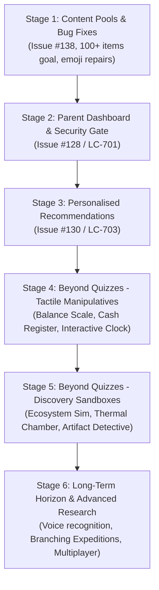

# Multi-Stage Strategic Plan: Replacing Quizzes, Quality Refinement & Innovation Roadmap

This document serves as the master blueprint for transitioning **Raven & Llama Learning** from a quiz-centric platform into a deeply interactive, inquiry-based educational experience. It covers immediate bug resolutions, content pool expansions (to meet the 100+ items goal), core architectural additions, tactile manipulatives replacing quizzes, and longer-term research into future learning mechanics.

---

## Executive Summary: The 6-Stage Roadmap



---

## Stage 1: Content Pools, Question Breadth & Bug Resolutions (Issue #138)

**Primary Objective**: Eliminate known defects, repair corrupted icons, and bring all eligible activities to the platform standard of **at least 100 distinct items per activity**.

### 1.1 Fix History Event Icons (Encoding Repair)
* **Problem**: 90 of 104 events in `public/js/history/events.js` currently render broken literal `'??'` strings instead of authentic emojis due to an encoding defect in PR #149.
* **Resolution**: Replace each `'??'` with an historically accurate thematic emoji (e.g. 🏛️ Parthenon, 🚢 Lapita voyages, 📜 Magna Carta, 🔭 Galileo, ⚔️ Battle of Hastings).
* **Test**: Add automated unit test verifying that every event has a valid emoji icon string of length $\ge 1$ and matching unicode emoji patterns.

### 1.2 Expand Geography Hub Dataset to 100+ Countries
* **Problem**: `public/js/geography/country-data.js` contains only 18 countries, even though `world-map-context.js` contains SVG paths for 177 countries. Consequently, Flag Detective and Capital Cities quizzes only ever test 18 countries.
* **Resolution**: Expand `country-data.js` to 100+ sovereign countries spanning Africa, Asia, Europe, North America, South America, and Oceania with verified flags, official capitals, continents, facts, and trusted source citations.
* **Test**: Add unit test in `tests/unit/geography-country-activities.test.js` asserting `countries.length >= 100` and zero duplicate country/flag/capital combinations.
* **Follow-up note**: The initial 100+ country target is now met, but the 177-feature map has additional geography records. Continue auditing it for eligible sovereign countries to add, and document any mapped dependencies or disputed entities that stay out of the country quiz pool.
* **Map-page facts follow-up**: Add about 5–10 distinct, age-appropriate facts for each country. Randomly select which fact appears whenever the learner changes the selected country, so returning to a country can reveal another fact. Flag rendering also still fails in desktop Chrome even though it works on a phone; investigate the Chrome-specific rendering path.

### 1.3 Expand Life Skills "Plan a Party"
* **Problem**: `public/js/life-skills/party-planner.js` features exactly one scenario ($100 budget) and 6 fixed items.
* **Resolution**:
  - Add 4 diverse event scenarios: Birthday Party ($100), Camping Trip ($150), School Science Fair ($75), and Pizza Movie Night ($50).
  - Expand item catalog from 6 to 24 items with category groupings (Venue, Food & Drink, Entertainment, Gear, Decorations).
  - Randomize item sets and required vs optional targets per round.
* **Test**: Add unit test ensuring at least 4 scenarios and 20+ valid items with budget constraints.

### 1.4 Expand Science Lab Food Chains & Virtual Lab
* **Food Chains**: Expanded `public/js/science/food-chains.js` to 10 sourced habitats. Five distinct chains are randomly selected per run; the deep-sea vent model correctly starts with chemical energy rather than sunlight.
* **Virtual Lab**: Expanded `public/js/science/virtual-lab.js` to 17 carefully sourced outcomes. Item filters group materials, prepared mixtures, conditions, and tools; supported outcomes link to their source.

### 1.5 Expand MathMasters Brown Belt Fractions
* **Problem**: `genBrownFractions` generates only 18 proper fractions across limited denominators `[2, 3, 4, 6, 8]`.
* **Resolution**: Expand to denominators up to 12, improper fractions, mixed numbers, and visual geometric models (circles, fraction bars, grid matrices) to exceed 100 distinct visual problems.

---

## Stage 2: Parent Dashboard & Settings Controls (Issue #128 / LC-701)

**Primary Objective**: Deliver a secure, dedicated parent portal enabling personalized difficulty configurations, learning pace controls, and safe progress management.

### 2.1 Backend & Authentication Layer
* **Parent Access Gate**:
  - Implement optional 4-to-6 digit Parent PIN for signed-in accounts.
  - Store PIN as a PBKDF2 hash with unique salt in the account profile; never store plaintext PINs.
  - Rate-limit PIN verification (5 attempts per minute) on `/api/auth/parent-verify`.
* **Reauthentication**: Require session re-entry or PIN verification before destructive operations.
* **Progress Reset Endpoint**:
  - Add scoped endpoint `/api/progress/reset` allowing parents to selectively reset activity scores and history while preserving account credentials and earned cosmetics.

### 2.2 Parent Dashboard UI & Controls
* **Navigation Entry**: Accessible lock icon in the top header and inside account settings.
* **Global & Subject Difficulty Matrix**:
  - Unified grid allowing parents to set school-year overrides individually for Mathematics, Science, and English/Spelling.
  - Visual guidance showing current year level (Foundation to Year 12) and recommended activity tiers (Easy, Medium, Hard).
* **Audio & Sensory Preferences**:
  - Global speech synthesis speed slider ($0.75\times$ to $1.25\times$).
  - Sound effects toggle and Dyslexia-friendly typography toggle.
* **Guest Safety**: In guest mode, display a clear advisory that settings and progress remain memory-only.

---

## Stage 3: Personalised Learning Recommendations (Issue #130 / LC-703)

**Primary Objective**: Turn student activity history into deterministic, explainable next-step recommendations that adapt to mastery and practice recency.

### 3.1 Deterministic Recommendation Engine (`lib/recommendations.mjs` & client)
* **Algorithm Inputs**:
  - Current school year and subject difficulty overrides.
  - Recent accuracy per skill in `activityProgress` (identifying skills with $< 70\%$ accuracy).
  - Recency gap (identifying core curriculum areas not practiced in $> 7$ days).
  - Daily challenge completion state.
* **Ranking & Selection**:
  - Priority 1: Remediation (low accuracy in recent attempts).
  - Priority 2: Incomplete Quests / Unearned Badges.
  - Priority 3: Breadth & Discovery (unpracticed subjects).
  - Fallback: Year-appropriate core activities when history is sparse.
* **Data Privacy**: All computations occur locally in-browser or strictly within the authenticated account session; zero external analytics tracking.

### 3.2 Learning Centre Recommendation Cards
* Surface top 3 recommended activities prominently on the Home dashboard and Learning Centre header.
* Include plain-language explanations:
  - *"Let's practice: You scored 60% on fractions last week. Try Fraction Pizza to level up!"*
  - *"New discovery: You haven't explored the History Timeline yet. Step back in time!"*
* Provide one-click direct launch buttons into the recommended activity.

---

## Stage 4: Replacing Quizzes — Tactile Manipulatives (Beyond Quizzes Phase 1)

**Primary Objective**: Move primary mathematics and language learning from multiple-choice testing into direct physical manipulation.

```text
Quiz Mindset:        "What is 3/4 + 1/4? [A] 1  [B] 2/4  [C] 4/8  [D] 1/2"
Manipulative Mindset: "Drag pizza slices into the box until you have exactly one whole pizza."
```

### 4.1 Digital Balance Scale (Maths Masters Algebra & Equations)
* **Concept**: Replace multiple-choice equation balancing with an interactive, animated two-pan beam balance scale.
* **Mechanics**:
  - Visual beam and pointer displaying real-time angle tilt using SVG or CSS transforms.
  - Weight repository: standard brass weights ($1, 2, 5, 10, 20$), mystery blocks ($x$), and helium balloons (negative values).
  - Students place blocks onto left and right pans. The scale responds physically with gravity and dampening until equilibrium is achieved.
* **Target Activity**: Replace `blue_balanced_equation` and `balance-scales` arcade.

### 4.2 Cash Register & Change Counter (Maths World Shopkeeper)
* **Concept**: Transform the money calculation quiz into an authentic shopkeeper cash register simulation.
* **Mechanics**:
  - Render an open cash register drawer with distinct slots for Australian bank notes ($50, $20, $10, $5) and coins ($2, $1, 50c, 20c, 10c, 5c).
  - A customer hands over cash for a grocery purchase.
  - The student drags coins and notes from the till onto the customer's counter. A tactile "running total" shows the change given, teaching counting up from the purchase price to the bill paid.
* **Target Activity**: Replaces multiple-choice selection in `public/js/mathmasters/money.js`.

### 4.3 Interactive Clockwork Hands (Maths World Telling Time)
* **Concept**: Replace multiple-choice digital clock matching with interactive draggable clock hands.
* **Mechanics**:
  - Smooth 360-degree touch and mouse dragging on the minute hand.
  - Realistic $12:1$ gear ratio linkage: rotating the minute hand smoothly turns the hour hand proportionally.
  - Target challenges: "Set the clock to quarter past 3" or "Show 25 minutes after 7:15".
  - An animated day/night window behind the clock shifts from dawn to midday to sunset, reinforcing AM/PM.
* **Target Activity**: Enhances `public/js/mathmasters/telling-time.js`.

### 4.4 Kinetic Phonics Soundboard & Blending Bar (Spelling Safari)
* **Concept**: Replace multiple-choice spelling selections with tactile phoneme blending.
* **Mechanics**:
  - Students see interactive letter/digraph tiles (`sh`, `i`, `p`).
  - Tapping each tile triggers localized audio pronunciation.
  - Swiping a finger across the "Blending Bar" underneath plays the continuous blended word ("sh-i-p... ship!"), showing phonological assembly.
* **Target Activity**: Enhances `public/js/spelling/safari.js` Phonics Trail.

---

## Stage 5: Replacing Quizzes — Discovery Sandboxes & Deductive Mysteries (Beyond Quizzes Phase 2)

**Primary Objective**: Transition Science, History, and Geography into exploratory sandboxes and mystery-solving investigations.

### 5.1 Trophic Ecosystem & Population Sandbox (Science Lab)
* **Concept**: An open ecosystem simulator demonstrating trophic cascades and ecological balance.
* **Mechanics**:
  - Canvas environment representing a living pond or savanna.
  - Students drag organisms (algae, tadpoles, fish, kingfishers) into the pond.
  - A simple time-step population graph shows live counts. If students introduce too many predators without sufficient producers, the prey population crashes, followed by predator starvation.
  - Challenges provide open goals: *"Establish a stable pond ecosystem with at least 3 species that survives for 30 simulated days."*

### 5.2 States of Matter Thermal Chamber (Science Lab)
* **Concept**: An interactive particle chamber demonstrating molecular behavior across temperatures.
* **Mechanics**:
  - A temperature slider spanning $-100^\circ\text{C}$ to $200^\circ\text{C}$ with burner and chiller controls.
  - Molecular viewport: Water molecules shown as animated balls.
  - At low temperatures, molecules vibrate within fixed crystalline lattices (solid ice). As heat rises, bonds loosen into flowing fluid (liquid water), and eventually break into high-velocity gas (steam).
  - Includes pressure gauges and condensation lid interactions.

### 5.3 Historical Artifact Detective (History Hub)
* **Concept**: A forensic archaeological investigation tool replacing rote historical date memorization.
* **Mechanics**:
  - The student is presented with an unidentified artifact unearthed at a dig site (e.g. an inscribed clay fragment, a bronze coin, a navigational astrolabe).
  - Tools provided:
    * **Magnifying Glass**: Inspect symbols, script, and imagery.
    * **Material Analyzer**: Test composition (papyrus, terracotta, iron, silk).
    * **Stratum Depth / Carbon Gauge**: Approximate the chronological epoch.
  - Students collect 3 observational clues and select the civilization or historical period that produced it, unlocking the artifact for the museum collection.

### 5.4 Globe Trotter Clue Trail (Geography Hub)
* **Concept**: A Carmen Sandiego-inspired mystery flight adventure across the interactive SVG world map.
* **Mechanics**:
  - A missing artifact or animal mystery unfolds across countries.
  - Witnesses give cultural and geographical clues:
    - *"The suspect exchanged money for Yen and mentioned visiting Mount Fuji."*
    - *"The traveler was heading to a southern hemisphere country known for the Southern Cross on its flag."*
  - The student navigates the interactive map, zooming and panning to fly to the correct country, unlocking passport stamps and facts along the way.

---

## Stage 6: Long-Term Horizon & Advanced Research

**Primary Objective**: Investigate cutting-edge educational mechanics, voice interaction, and cooperative features for future platform iterations.

### 6.1 Voice Recognition & Verbal Spelling (Web Speech Recognition)
* **Research Focus**: Can speech recognition reliably assess oral reading and verbal spelling for primary students without external cloud services?
* **Feasibility**:
  - Evaluate the browser's native `webkitSpeechRecognition` / `SpeechRecognition` API.
  - Challenges: Background noise, child accents, and speech recognition latency.
  - Opportunity: "Spell-by-voice" where a student speaks individual letters aloud: *"T - I - G - E - R"*, with on-screen visual confirmation.

### 6.2 Branching Historical Expeditions (Choose-Your-Own-Adventure)
* **Research Focus**: Interactive branching narratives exploring major human migrations and historical journeys.
* **Prototypes**:
  - *The Silk Road Caravan*: Manage supplies (water, silk, camels) while deciding trade routes between Chang'an and Constantinople.
  - *Pacific Wayfinding*: Use star navigation and wave patterns to guide a voyaging canoe between Polynesian islands.

### 6.3 Real-Time Cooperative Challenges via Cloudflare Durable Objects
* **Research Focus**: Low-latency, privacy-preserving multiplayer cooperation without user chat or external accounts.
* **Prototypes**:
  - *Maths Relay*: Two students in a classroom work together to solve parts of a puzzle concurrently.
  - *Ecosystem Co-op*: One student manages plant nutrition while the other balances herbivores in a shared simulation.
  - Architecture: Lightweight Cloudflare Workers WebSocket connections backed by ephemeral Durable Objects.
